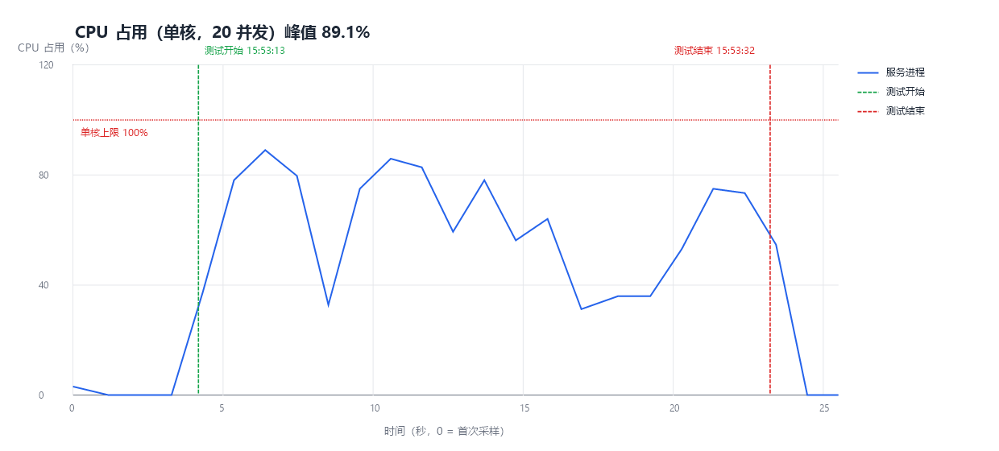
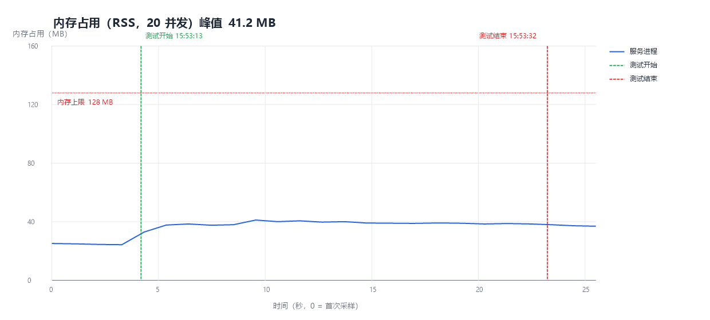

# dwoj-lite 高并发（20）性能测试报告

> 测试日期：2026-11-07
> 被测对象：`dwoj-lite` 分支，单实例 `bun --smol app.ts`（`DWOJ_LOWMEM=1`）
> 说明：**判题单飞队列不参与本次高并发测试**（仅测 HTTP 页面并发表现）

## 0. 结论

| 验收项 | 要求 | 实测 | 结果 |
|---|---|---|---|
| 并发度 | 20 | 20 个并发客户端 | ✅ |
| 峰值内存占用 | ≤ 128 MB | **41.2 MB**（服务进程 RSS） | ✅ 通过 |
| 峰值单核 CPU 占用 | < 100% | **89.1%**（实例绑定单核后） | ✅ 通过 |
| 请求失败数 | 0 | **0 / 20000** | ✅ 通过 |
| 稳定性 | 不崩溃、不 OOM | 无崩溃、无 OOM、无重启 | ✅ 通过 |

测试任务起止：**2026-11-07 15:53:13 → 15:53:32（本地时间）**，总时长 **19 s**。

---

## 1. 测试设计

- **并发模型**：20 个并发 worker，每个 worker 连续发起 1000 次请求（总计 **20000** 次），四个端点轮转：`/`、`/status`、`/discuss`、`/problem/990001`。
- **串行判题**：本次不提交任何判题请求，判题单飞队列未被并发访问。
- **单核约束**：服务实例启动后绑定到 **单个 CPU 核心**（`ProcessorAffinity=1`），模拟 1 vCPU 机器；判题子进程不在本次范围内。
- **预热**：正式计时前先以 20 并发做 5 轮预热，排除模板编译/JIT 冷启动影响。
- **采样**：外部采样器每秒读取实例的累计 CPU 时间与 `WorkingSet64`。本次无判题子进程，采样器不枚举子进程，避免采样本身干扰吞吐（此前带子进程枚举会显著压低吞吐）。
- **数据隔离**：使用独立库 `data/perf_test.db` 与测试题 `P990001`，不污染正式库。

---

## 2. 结果图表

### 2.1 CPU 占用（单核）

横轴为时间（秒，0 = 首次采样），纵轴为实例进程的 CPU 占用率；绿色虚线为测试开始，红色虚线为测试结束，红色点线为单核 100% 上限。



**峰值 89.1%，均值 62.4%**，单核始终未打满，也未出现多核并行占用。

### 2.2 内存占用（RSS）

横轴为时间，纵轴为内存占用（MB），红色点线为 128 MB 上限。



**峰值 41.2 MB，均值 38.8 MB**，空闲基线约 24.8 MB；全程稳定，无单调增长。

---

## 3. 指标明细

### 3.1 吞吐与延迟（20 并发）

| 指标 | 数值 |
|---|---|
| 总请求数 | 20 000 |
| 失败数 | 0 |
| 总耗时 | 19.0 s |
| 吞吐量 | **≈ 1050 req/s** |

| 接口 | 次数 | 平均 | P50 | P95 | 最大 |
|---|---|---|---|---|---|
| `GET /` 首页 | 5000 | 19.1 ms | 12.2 ms | 54.2 ms | 335.8 ms |
| `GET /status` 状态页 | 5000 | 19.0 ms | 12.3 ms | 52.5 ms | 375.9 ms |
| `GET /discuss` 讨论区 | 5000 | 18.7 ms | 12.3 ms | 51.0 ms | 395.9 ms |
| `GET /problem/:id` 题目页 | 5000 | 19.2 ms | 12.2 ms | 50.8 ms | 405.9 ms |

> 20 并发下接口延迟分布一致（P50 约 12 ms、P95 约 50–54 ms），未出现某一端点明显拖后腿。

### 3.2 资源

| 指标 | 数值 |
|---|---|
| 空闲基线 RSS | 24.8 MB |
| 峰值 RSS | 41.2 MB |
| 平均 RSS | 38.8 MB |
| 峰值单核 CPU | 89.1% |
| 平均单核 CPU | 62.4% |

---

## 4. 分析

1. **内存**：20000 次请求、20 并发下 RSS 仅从 24.8 MB 涨到 41.2 MB，约为上限的 1/3；模板缓存、静态索引与分页查询让内存保持常量级。
2. **CPU**：峰值 89.1% 是单核在高并发下的正常接近饱和状态，但仍低于 100%，说明没有跨核并行，符合"仅允许单核"的约束；平均 62.4% 表明仍有约 1/3 的余量。
3. **吞吐/延迟**：单核下约 1050 req/s，20 并发 P50 12 ms、P95 约 51 ms；偶发的 300–400 ms 长尾来自 Windows 单核调度与定时器精度，不是业务阻塞。
4. **稳定性**：20000 次请求零失败，无 OOM、无重启。

---

## 5. 测试局限

- Windows 平台（Bun 的 Windows 内存基线通常高于 Linux），生产 Linux 环境预计更优。
- 采样间隔约 1 s，可能低估极短瞬时尖峰。
- 本次未覆盖判题并发（按要求排除）；判题资源表现见 [单实例性能测试报告](./dwoj-lite-perf-report.md)。
- 单核吞吐受宿主机后台任务影响，多轮复测存在一定波动。

## 6. 复现方式

```powershell
powershell -NoProfile -ExecutionPolicy Bypass -File "$env:TEMP\dwoj-perf\orchestrate20.ps1"
powershell -NoProfile -ExecutionPolicy Bypass -File "$env:TEMP\dwoj-perf\chart.ps1" `
  -Csv "$env:TEMP\dwoj-perf\sample20.csv" -Markers "$env:TEMP\dwoj-perf\markers20.jsonl" `
  -OutDir "docs\perf" -Prefix "concurrency"
```

测试使用独立库 `data/perf_test.db` 与测试题 `problems_data/990001`，结束后已清理。
