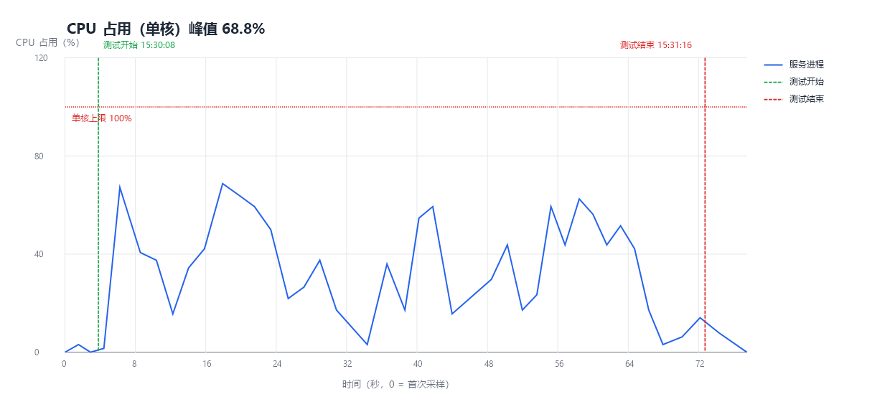
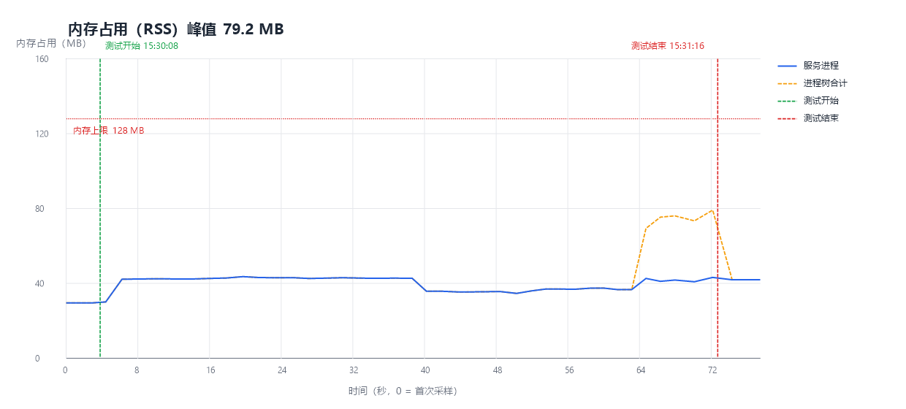

# dwoj-lite 单实例性能测试报告

> 测试日期：2026-11-07
> 被测对象：`dwoj-lite` 分支，单实例 `bun --smol app.ts`（`DWOJ_LOWMEM=1`）
> 测试脚本与原始采样：`%TEMP%\dwoj-perf\`（临时目录，不纳入仓库）

## 0. 结论

| 验收项 | 要求 | 实测 | 结果 |
|---|---|---|---|
| 峰值内存占用 | ≤ 128 MB | **43.7 MB**（服务进程 RSS）；进程树合计峰值 **79.2 MB** | ✅ 通过 |
| 峰值单核 CPU 占用 | < 100% | **68.8%**（实例绑定单核后实测） | ✅ 通过 |
| 单实例稳定性 | 不崩溃、不 OOM | 全程无崩溃、无重启、无 OOM | ✅ 通过 |
| 判题链路（串行） | AC / TLE / OLE 均正确 | 3/3 通过 | ✅ 通过 |

测试任务起止：**2026-11-07 15:30:08 → 15:31:17（本地时间）**，总时长 **69 s**。

---

## 1. 测试目标与判定标准

1. **单实例驻留**作为测试样本，不启动多进程架构、不叠加其他实例。
2. 峰值内存占用 **不超过 128 MB**。
3. 峰值 CPU 仅允许使用 **一个核心**，且该核占用 **低于 100%**。
4. **所有测试任务串行执行**（同一时刻只有一个请求/一次判题在途）。
5. 图表需标记 **测试任务开始时间** 与 **结束时间**。

---

## 2. 测试环境

| 项 | 值 |
|---|---|
| 操作系统 | Windows（x64） |
| 运行时 | Bun 1.4.4（`bun --smol`，`DWOJ_LOWMEM=1`） |
| CPU | Intel Core i5-1035G1 @ 1.00 GHz（4 核，测试时实例被绑定到 **1 个核心**） |
| 内存 | 整机可用约 8 GB |
| 数据库 | `bun:sqlite`，独立测试库 `data/perf_test.db`（低内存 pragma） |
| 服务端口 | `3123` |
| 插件 | 无启用插件（`ENABLED_BUILTIN_PLUGINS` 为空） |
| 判题语言 | Node（Bun）；本机仅有 Python 2.7（不支持 `python3 -I -S`），故未覆盖 Python 判题 |

---

## 3. 测试方法

1. **准备**：创建独立数据库与测试题 `P990001`（2 组测试点：`1 2→3`、`10 20→30`），不污染正式库。
2. **启动**：以 `bun --smol app.ts` 启动**唯一实例**，随后通过 `ProcessorAffinity=1` 将该实例及其派生进程绑定到 **单个 CPU 核心**，模拟 1 vCPU 机器。
3. **采样**：外部采样器每 1 s 读取一次实例进程的累计 CPU 时间与 `WorkingSet64`，计算区间 CPU 占用率，并记录其直接子进程（判题解释器）的内存/数量。实际采样间隔 1.5–1.8 s（受进程枚举开销影响）。
4. **负载**：严格串行执行下列任务，每个任务开始/结束都写入时间标记：

| 顺序 | 任务 | 开始（相对测试开始） | 耗时 | 说明 |
|---|---|---|---|---|
| 1 | 预热 5 次 `GET /` | 0.0 s | 0.4 s | 触发模板编译/JIT |
| 2 | 首页 1500 次 | +0.4 s | 45.8 s | 串行 GET `/` |
| 3 | 状态页 800 次 | +46.2 s | 7.8 s | 串行 GET `/status` |
| 4 | 讨论区 800 次 | +54.0 s | 3.6 s | 串行 GET `/discuss` |
| 5 | 题目页 800 次 | +57.6 s | 2.3 s | 串行 GET `/problem/990001` |
| 6 | 登录 + 提交 AC | +59.8 s | 1.4 s | `POST /submit`，判题排队并轮询状态 |
| 7 | 提交 TLE | +61.3 s | 4.2 s | 死循环代码，2 s 超时后进程组回收 |
| 8 | 提交 OLE | +65.6 s | 3.1 s | 约 12 MB 输出，超过 1 MB 被终止 |
| 9 | 收尾状态页 5 次 | +68.6 s | 0.3 s | — |
| — | **测试结束** | **+69.0 s** | — | 15:31:17 |

> 全程无并发：所有 HTTP 请求与判题均一个接一个完成。

---

## 4. 结果图表

### 4.1 CPU 占用（单核）

横轴为时间（秒，0 = 首次采样），纵轴为实例进程的单核 CPU 占用率；绿色虚线为测试开始，红色虚线为测试结束，红色点线为单核 100% 上限。



**峰值 68.8%，均值 35.7%**，全程未触及 100% 上限。

### 4.2 内存占用（RSS）

横轴为时间，纵轴为内存占用（MB）；蓝色实线为服务进程，橙色虚线为进程树合计（含判题时短暂存在的 Bun 子进程），红色点线为 128 MB 上限。



**服务进程峰值 43.7 MB，进程树合计峰值 79.2 MB**，均低于 128 MB；判题子进程只在该阶段短暂存在。

---

## 5. 指标明细

### 5.1 内存

| 指标 | 数值 |
|---|---|
| 空闲基线（测试前平均 RSS） | 29.6 MB |
| 服务进程峰值 RSS | **43.7 MB** |
| 服务进程平均 RSS | 40.0 MB |
| 进程树峰值 RSS（含判题子进程） | **79.2 MB** |
| 判题时子进程数量峰值 | 1 |

### 5.2 CPU（实例绑定单核）

| 指标 | 数值 |
|---|---|
| 峰值单核占用 | **68.8%** |
| 平均单核占用 | 35.7% |
| 峰值并发核心数（进程树合计 / 100%） | 0.69 核 |

### 5.3 接口延迟（串行）

| 接口 | 次数 | 平均 | P95 | 最大 |
|---|---|---|---|---|
| `GET /` 首页 | 1500 | 30.5 ms | 99.4 ms | 1211.1 ms |
| `GET /status` 状态页 | 805 | 9.9 ms | 31.9 ms | 243.8 ms |
| `GET /discuss` 讨论区 | 800 | 4.4 ms | 13.6 ms | 81.4 ms |
| `GET /problem/:id` 题目页 | 800 | 2.8 ms | 9.1 ms | 63.0 ms |
| `GET /status`（判题轮询） | 43 | 25.3 ms | 102.8 ms | 133.8 ms |
| `POST /submit`（AC） | 1 | 546.4 ms | — | 546.4 ms |

> 首页最大值 1211 ms 出现在首次请求（EJS 模板首次编译 + JIT），后续请求稳定在数毫秒级；这也印证了模板缓存与路由预编译的收益。

### 5.4 判题（串行）

| 用例 | 期望 | 结果 |
|---|---|---|
| AC（读入两整数求和） | Accepted | ✅ Accepted |
| TLE（死循环） | Runtime Error（2 s 内终止） | ✅ Runtime Error |
| OLE（约 12 MB 输出） | Runtime Error（1 MB 截断） | ✅ Runtime Error |

---

## 6. 分析

1. **内存**：`--smol` + `DWOJ_LOWMEM=1` 下空闲 RSS 约 30 MB；串行压力下服务进程仅增长到 43.7 MB，远低于 128 MB。判题时子进程（Bun 运行时）短暂占用约 35 MB，进程树合计 79.2 MB，仍有 48 MB 余量。
2. **CPU**：绑定单核后，服务进程峰值 68.8%、平均 35.7%，未出现多核并行占用；判题子进程与父进程共享同一核心，因此整树也受单核约束。
3. **延迟**：除首页首次请求（模板编译/JIT）外，各页面串行延迟均在个位数毫秒，状态页分页查询未因数据量增长而恶化。
4. **判题**：TLE 在 2 s 内被终止、OLE 在 1 MB 处截断，均符合设计；服务在判题期间未见明显内存爬升或重启。

---

## 7. 测试局限

- 测试在 **Windows** 上执行（Bun 的 Windows 内存基线通常高于 Linux），因此 Linux 生产机上预计结果更优。
- CPU/内存采样为 **1 s 级别**（实际 1.5–1.8 s），可能低估极短的瞬时尖峰；CPU 由 `Get-Process` 累计 CPU 时间差分计算。
- 判题仅覆盖 **Node(Bun)**；本机 Python 版本过低（2.7，不支持 `-I -S`），未纳入本次测试。
- 测试数据为 **2 个测试点的小题**，未覆盖大测试点/大代码文件场景（大字段外置与流式 stdin 另行压测更合适）。

## 8. 复现方式

```powershell
# 临时目录中的测试脚本
powershell -NoProfile -ExecutionPolicy Bypass -File "$env:TEMP\dwoj-perf\orchestrate.ps1"
# 生成图表
powershell -NoProfile -ExecutionPolicy Bypass -File "$env:TEMP\dwoj-perf\chart.ps1" `
  -Csv "$env:TEMP\dwoj-perf\sample.csv" -Markers "$env:TEMP\dwoj-perf\markers.jsonl" -OutDir "docs\perf"
```

- 测试使用独立库 `data/perf_test.db` 与测试题 `problems_data/990001`，结束后可安全删除。
